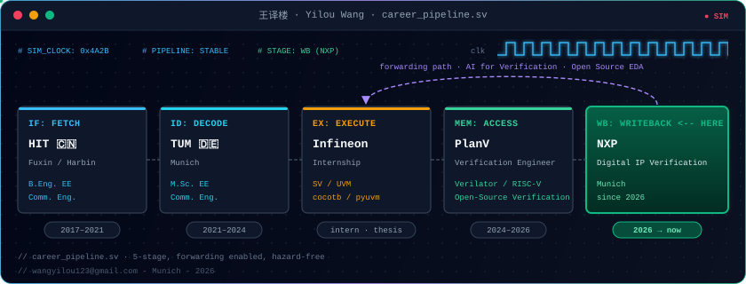
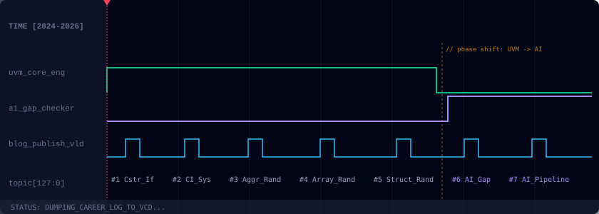

<div align="center">
  
</div>

# 王译楼 · Yilou Wang 👋

> **Digital IP Verification Engineer @ NXP Munich · previously PlanV · TUM M.Sc.**
> Verilator org member · 160+ merged PRs in Verilator · UVM on open-source simulators · AI for verification

<p>
  
  <a href="https://github.com/verilator/verilator/pulls?q=is%3Apr+is%3Amerged+author%3AYilouWang"></a>
  
</p>

```systemverilog
module Yilou_Wang_Career (
  input  logic        clk,
  input  logic        rst_n,
  output logic [31:0] career_impact
);

  // IF: Harbin Institute of Technology
  localparam string IF_STAGE  = "HIT · B.Sc. EE / Comm. Eng.";

  // ID: Technical University of Munich
  localparam string ID_STAGE  = "TUM · M.Sc. EE / Comm. Eng.";

  // EX: Infineon Technologies (internship + master thesis)
  localparam string EX_STAGE  = "Infineon · SV / UVM / cocotb / pyuvm";

  // MEM: PlanV (2024-2026)
  localparam string MEM_STAGE = "PlanV · UVM on Verilator · 160+ merged PRs · agentic dev loop";

  // WB: NXP Semiconductors (current stage)
  localparam string WB_STAGE  = "NXP · Digital IP Verification";

  // forwarding path: AI for Verification · Open-Source EDA

  always_ff @(posedge clk or negedge rst_n) begin
    if (!rst_n) career_impact <= 32'h0;
    else        career_impact <= career_impact + 32'd1;  // keep shipping
  end

endmodule
```

---

## Highlights

- 🚀 **[160+ merged pull requests in Verilator](https://github.com/verilator/verilator/pulls?q=is%3Apr+is%3Amerged+author%3AYilouWang)**: constrained randomization, SVA and UVM-related features. Member of the Verilator GitHub organization.
- 🧪 **Industrial UVM on an open-source simulator**: OpenHW's cv32e40p UVM testbench (core-v-verif) running natively on Verilator, 0 UVM_FATAL / 0 UVM_ERROR.
- 🤖 **[Agentic AI development loop](https://planv.tech/2026/06/01/verilator-developer-an-ai-native-pipeline-for-verilator-contributions/)**: 82 merged PRs in three months, human review on every patch.

---

## Journey

- 🎓 2017–2021: 🇨🇳 B.Eng. EE @ HIT (Fuxin 🚄 Harbin)
- 🎓 2021–2024: 🇩🇪 M.Sc. EE @ TUM (China ✈️ Munich)
- 🧪 Internships: Neusoft & Infineon (master thesis at Infineon)
- 💼 2024–2026: Verification Engineer @ PlanV
- 💼 2026–now: Digital IP Verification Engineer @ NXP

---

## Publications & Talks

- 🎤 **AI on Open-Source EDA: Closing the UVM-on-Verilator Gap with an Agentic Development Loop**, DVCon Europe 2026 · Munich, Nov 17–18, 2026
- 📄 **Enabling Industrial-Grade RISC-V UVM Verification on an Open-Source Simulator**, Euromicro DSD 2026 (MATTERV) · Kraków, Sep 2026
- 📄 **Advancing Open-Source Verification: Enabling Full Randomization in Verilator**, DVCon Europe 2025
- 📄 **Enable Reuse of SystemVerilog Verification IPs in cocotb/pyuvm**, DVCon Europe 2024 (with Thorsten Dworzak and Johannes Grinschgl)

---

## 📝 Technical Writing

<div align="center">
  
</div>

- **#1** · 2024.08 · [UVM in Verilator: Constraint random if/else](https://planv.tech/2024/08/02/enabling-uvm-support-in-verilator-series-part-1-constraint-random-ifelse-constraint-support/)
- **#2** · 2024.10 · [UVM in Verilator: CI system and test models](https://planv.tech/2024/10/08/enabling-uvm-support-in-verilator-series-our-ci-system-and-test-models/)
- **#3** · 2024.11 · [UVM in Verilator: Aggregate data type randomization](https://planv.tech/2024/11/07/enabling-uvm-support-in-verilator-series-basic-randomization-support-for-aggregate-data-types/)
- **#4** · 2025.02 · [UVM in Verilator: Array constrained randomization](https://planv.tech/2025/02/07/enabling-uvm-support-in-verilator-series-constrained-randomization-support-for-all-types-of-arrays/)
- **#5** · 2025.07 · [UVM in Verilator: Struct constrained randomization](https://planv.tech/2025/07/04/enabling-uvm-support-in-verilator-series-constrained-randomization-support-for-structs/)
- **#6** · 2026.02 · 🤖 [Verilator Gap Checker with AI](https://planv.tech/2026/02/24/verilator-gap-checker-automatically-detecting-feature-gaps-in-verilator-with-ai/)
- **#7** · 2026.06 · 🤖 [Verilator Developer: an AI-native pipeline for Verilator contributions](https://planv.tech/2026/06/01/verilator-developer-an-ai-native-pipeline-for-verilator-contributions/)

---

## Projects

- 🧰 [Toy4Joy_DV](https://github.com/YilouWang/Toy4Joy_DV): DV playground for SV / UVM / Verilator / cocotb, with practical examples for onboarding and quick experiments.
- 📘 [cocotb-BSHL](https://github.com/Infineon/cocotb-BSHL): my master thesis work at Infineon, giving cocotb/pyuvm access to SystemVerilog verification IP.
- 🧪 [PlanV_Verilator_Feature_Tests](https://github.com/planvtech/PlanV_Verilator_Feature_Tests): the CI flow we used at PlanV to validate Verilator features.
- 🎠 [badai_cardsmith-oss](https://github.com/YilouWang/badai_cardsmith-oss): side project, a carousel-card generator for Chinese content creators with a quality-scoring loop.

---

## Contact

<p>
  <a href="https://www.linkedin.com/in/yilou-wang-a0569b215/">
    
  </a>
</p>

- Email: [wangyilou123@gmail.com](mailto:wangyilou123@gmail.com)

<sub>Open-source work shown here was done during my time at PlanV and before. Views are my own.</sub>

